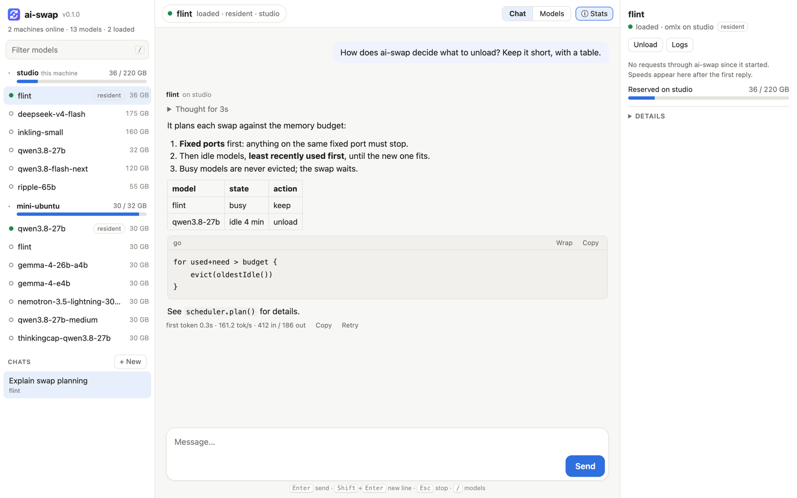
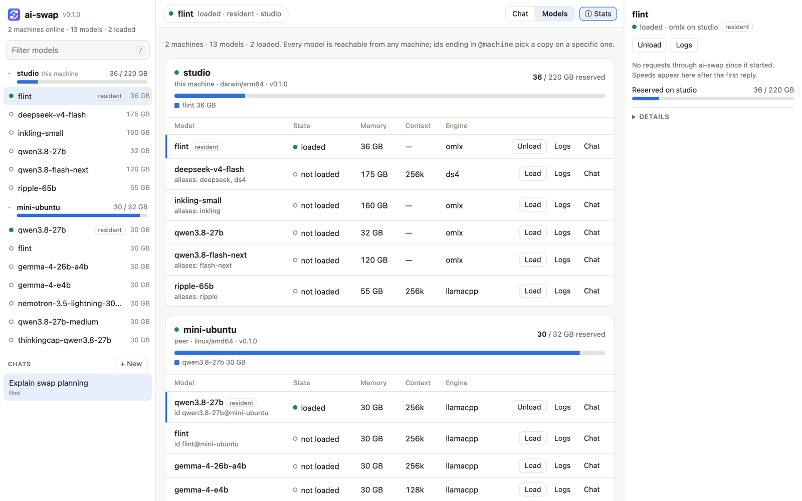

# ai-swap

**One endpoint and one chat UI for all the local models on all your machines.**

ai-swap is a small Go program that sits in front of local inference engines.
A client sends an OpenAI or Anthropic request naming a model. ai-swap then:

1. finds which machine serves that model,
2. starts the right engine there, unloading idle models first if memory is
   short, and
3. streams the answer back.

It is inspired by [llama-swap](https://github.com/mostlygeek/llama-swap) but
built for the newer single-model engines and for running several machines as
one pool.

> **Status: v0.1.0, early.** The core works: routing, swapping, peers,
> streaming and the chat UI, all covered by tests. The launch flags for Sushi
> and Strata still need checking on real hardware. See [Known gaps](#known-gaps).

| Chat | Models across machines |
|---|---|
|  |  |

---

## Contents

- [Why](#why)
- [Features](#features)
- [Supported engines](#supported-engines)
- [Install](#install)
- [Quick start (one machine)](#quick-start-one-machine)
- [Several machines](#several-machines)
- [Configuration reference](#configuration-reference)
- [Using it](#using-it)
- [HTTP API](#http-api)
- [Running as a service](#running-as-a-service)
- [Troubleshooting](#troubleshooting)
- [Security](#security)
- [Known gaps](#known-gaps)
- [Development](#development)
- [License](#license)

## Why

llama-swap is great for one box running llama.cpp. The newer engines change
the problem:

- **Every engine is different.** Sushi, ds4 and Strata each have their own
  binary, flags, model formats, default port and supported platforms.
- **Models are huge.** A 64–128 GB model leaves room for little else, so
  swapping has to be planned around memory rather than just "start what was
  asked for".
- **Engines are tied to hardware.** Sushi only runs on Apple Silicon. Strata
  suits NVIDIA and AMD GPUs. ds4 targets Metal, DGX Spark and Strix Halo. So
  your models end up spread over several machines, and you want one place to
  reach them all.

## Features

- **OpenAI and Anthropic APIs** with streaming: `/v1/chat/completions`,
  `/v1/completions`, `/v1/responses`, `/v1/embeddings`, `/v1/messages`.
  Works with OpenAI SDKs, Open WebUI and Claude Code.
- **Engine adapters** for Sushi, ds4, Strata and llama.cpp, plus `generic`
  for any other OpenAI-compatible server (MLX, vLLM, SGLang, ...).
- **Memory-aware swapping.** Each machine has a memory budget. Idle models
  are unloaded least-recently-used first to make room. A model in the middle
  of a reply is never killed; the swap waits for it.
- **Several machines as one pool.** Every machine runs the same binary and
  lists the others as peers. A request for a model on another machine is
  forwarded there. `model@node` picks a specific machine.
- **Idle timeout and crash recovery.** Models unload after a configurable
  idle time. A model whose process dies is restarted on the next request.
- **Built-in chat UI.** Streamed replies, a collapsible "thinking" section
  for reasoning models, tokens/sec, a memory bar per machine that shows which
  models hold the memory, replies labelled with the machine that served them,
  and load/unload/log buttons for every model.
- **Single static binary**, YAML config, no database.

## Supported engines

| Engine | `engine:` | Runs on | API | Adapter status |
|---|---|---|---|---|
| [llama.cpp](https://github.com/ggml-org/llama.cpp) `llama-server` | `llamacpp` | macOS, Linux (CUDA, ROCm, Vulkan, Metal) | OpenAI + Anthropic | Flags well known; ports assigned by ai-swap |
| [Sushi](https://github.com/joshuaswarren/sushi) | `sushi` | macOS, Apple Silicon | OpenAI + Anthropic | Checked on an M5 Ultra (sushi 1.4.1): `sushi --serve`, ports assigned by ai-swap |
| [ds4 / DwarfStar4](https://github.com/antirez/ds4) | `ds4` | macOS (Metal), Linux (DGX Spark CUDA, Strix Halo ROCm) | OpenAI + Anthropic | Checked on an M5 Ultra: ports assigned by ai-swap |
| [oMLX](https://github.com/jundot/omlx) | `omlx` | macOS, Apple Silicon | OpenAI + Anthropic | Checked on an M5 Ultra (oMLX 0.7.3). `model:` is the model's folder; weights load before `ready` |
| [Strata](https://github.com/Niko1221/Strata) | `strata` | NVIDIA, AMD (incl. Radeon AI PRO R9700), Apple Silicon | OpenAI + Anthropic | Needs `cmd:`, because `strata launch` is interactive. Fixed port 8080 unless your `cmd:` uses `${PORT}` |
| Anything OpenAI-compatible | `generic` | anywhere | OpenAI | You supply `cmd:` |

If an engine's flags differ from what the adapter expects, you can fix it in
config (`bin`, `args`, `port_flag`, `host_flag`, or a full `cmd`) without
changing code.

## Install

You need **Go 1.24 or newer** and **macOS or Linux**. Windows isn't supported
yet, because ai-swap uses Unix process groups to stop engines cleanly.

```bash
git clone https://github.com/hofftodd/ai-swap
```

```bash
cd ai-swap && go build -o ai-swap ./cmd/ai-swap
```

```bash
./ai-swap -version
```

To cross-compile for another machine, for example a DGX Spark (Linux, ARM):

```bash
GOOS=linux GOARCH=arm64 go build -o ai-swap-linux-arm64 ./cmd/ai-swap
```

## Quick start (one machine)

Create `config.yaml`:

```yaml
node:
  name: mac
  listen: 127.0.0.1:8686
  memory_budget_gb: 110      # leave headroom for the OS

models:
  qwen-flash-next:
    engine: sushi
    model: ~/.sushi/models/Qwen3.8-Flash-Next-Sushi-3bpw
    ctx: 131072
    memory_gb: 64
    aliases: [qwen]
```

Check it. This prints the exact command each model would be started with:

```bash
./ai-swap -config config.yaml -check
```

Run it:

```bash
./ai-swap -config config.yaml
```

Open <http://127.0.0.1:8686/> and pick a model. The first request loads the
model, which can take a minute or more for large models.

## Several machines

Run ai-swap on every machine. Each one lists the others under `peers`:

```
 clients ──► mac:8686 ─┬─► sushi  (Qwen3.8 Flash Next)      local
                       ├─► ds4    (DeepSeek V4 Flash)       local
                       └─► linux:8686 ─┬─► strata           R9700
                                       └─► llama-server     R9700
```

```yaml
# on the Mac
peers:
  - name: linux
    url: http://linux.local:8686
```

```yaml
# on the Linux box
peers:
  - name: mac
    url: http://mac.local:8686
```

Each machine polls its peers every 10 seconds. `GET /v1/models` on any
machine lists every machine's models. Full examples:

- [`examples/mac.yaml`](examples/mac.yaml): Sushi + ds4 + an MLX model
- [`examples/linux-r9700.yaml`](examples/linux-r9700.yaml): Strata + llama.cpp on a 32 GB Radeon AI PRO R9700

Set `listen: 0.0.0.0:8686` so peers can reach each other, and read
[Security](#security) first.

**Where requests go:**
- If this machine has the model (or an alias of it) and can run its engine
  on this OS, the request is served here.
- Otherwise it is forwarded to an online peer that has the model, preferring
  one where the model is already loaded.
- `name@node` forces a particular machine.
- Forwarded requests carry an `X-AI-Swap-Hop` header and are never forwarded
  again, so peers can't bounce a request back and forth.

## Configuration reference

```yaml
node:
  name: mac                  # default: hostname
  listen: 127.0.0.1:8686     # default: 127.0.0.1:8686
  memory_budget_gb: 110      # total for loaded models; 0 = no limit
  port_range: [9100, 9199]   # ports handed to engines that accept a port flag
  resident: [qwen-flash-next] # loaded at startup and kept loaded by default (see below)

peers:                       # other ai-swap machines
  - name: linux
    url: http://linux.local:8686

defaults:
  ttl: 30m                   # unload after this much idle time; 0 = never (default 0)
  health_timeout: 10m        # max time to wait for a model to become ready (default 10m)

engines:                     # per-machine install details, keyed by engine name
  ds4:
    bin: ~/src/ds4/ds4-server  # binary; defaults to the engine's usual name
    dir: ~/src/ds4             # working directory
    args: [--kv-disk-dir, ~/.ds4/kvcache]   # added to every model of this engine
    env: {SOME_VAR: value}
    port_flag: --port        # if set, ai-swap assigns ports instead of using the fixed one
    host_flag: --host

models:
  deepseek-v4-flash:         # the name clients send as "model"
    engine: ds4              # sushi | ds4 | strata | llamacpp | generic
    model: ds4flash.gguf     # path or id passed to the engine's model flag
    ctx: 65536               # context length; omitted = engine default
    memory_gb: 100           # expected footprint, used for the budget
    args: [--mtp]            # extra flags
    env: {}                  # extra environment
    aliases: [deepseek]      # extra names clients may use
    ttl: 1h                  # overrides defaults.ttl
    health_timeout: 15m      # overrides defaults.health_timeout
    health_path: /v1/models  # readiness URL; engine default if omitted
    port: 8000               # force a fixed port
    upstream_model: ""       # rewrite "model" before sending to the engine
    cmd: ""                  # replace the whole command; see below
```

**`resident`** names the models a node keeps loaded by default, such as
the one your coding agents use most. A resident model:

- is loaded when ai-swap starts,
- is never unloaded for being idle (its `ttl` is ignored),
- still gives way when another model needs the memory: it is evicted like
  any idle model, least recently used first, and
- comes back by itself once there is room again, for example after the
  swapped-in model's `ttl` expires. A reload never evicts another model,
  and waits behind any request that is queued for a swap.

Unloading a resident model by hand (Models tab or `/unload`) keeps it
unloaded until something loads it again. Together, residents must fit in
`memory_budget_gb`.

**`cmd`** replaces the generated command line. It is split like a shell
would split it (quotes and backslashes work), but no shell runs it. These
placeholders are filled in: `${PORT}`, `${MODEL}`, `${CTX}`.

```yaml
  small-mlx:
    engine: generic
    cmd: mlx_lm.server --model mlx-community/Qwen3-4B-4bit --port ${PORT}
    memory_gb: 4
```

`~` at the start of `model`, `bin`, `dir` and `args` entries expands to your
home directory. Unknown keys are rejected, so a typo like `memroy_gb` fails
loudly instead of being ignored.

## Using it

### Chat UI

Open `http://<machine>:8686/`.

- **Left sidebar:** a filter box (press `/`), every model grouped by machine
  with that machine's memory bar in its header, and your chats. Loaded models
  are listed first. Click a model to chat with it; hover a row for Load or
  Unload. Machine groups collapse.
- **Top bar:** the current model and its state, Chat / Models views, and the
  Stats toggle. On a phone, ☰ opens the sidebar as a drawer.
- **Chat:** streamed replies with Markdown (headings, lists, tables, code
  with copy and wrap), a collapsible "Thought for N s" block for reasoning
  models, and Copy / Retry / Edit on messages. If the selected model isn't
  loaded, a note above the message box says what sending will load and what
  it will unload. While a model loads, the reply shows "Loading… N s".
  Conversations are kept in your browser's local storage.
- **Stats** (right pane, or a drawer on narrow screens): generation and
  prompt tok/s, time to first token, a speed sparkline, a one-line summary
  of the model, GPU memory, and a collapsed Details section. Generation and
  prompt tok/s, time to first token, token counts and draft acceptance are
  measured by ai-swap on every request, so they work with any engine;
  llama.cpp's own timings are preferred when present. Details adds what the
  engine reports once loaded (parameters, quantization, context, slots,
  counters), process memory, and on Linux with AMD GPUs, VRAM/GTT per card.
- **Models view:** a table of every model on every machine with Load/Unload
  and Logs. Logs open in a dialog that follows the output.
- Keys: `/` filter models, `Esc` stop a reply or close a drawer,
  `Ctrl/⌘+Shift+O` new chat. A banner appears if the server can't be reached.

### curl / OpenAI SDKs

```bash
curl http://mac.local:8686/v1/chat/completions \
  -H 'Content-Type: application/json' \
  -d '{"model":"qwen","stream":true,"messages":[{"role":"user","content":"hello"}]}'
```

```python
from openai import OpenAI
client = OpenAI(base_url="http://mac.local:8686/v1", api_key="unused")
print(client.chat.completions.create(
    model="deepseek",
    messages=[{"role": "user", "content": "hello"}],
).choices[0].message.content)
```

### Claude Code and other Anthropic-API clients

```bash
ANTHROPIC_BASE_URL=http://mac.local:8686 ANTHROPIC_MODEL=deepseek-v4-flash claude
```

`/v1/messages` is routed the same way as OpenAI requests and passed straight
to the engine, with one fix-up: Claude Code puts `system`-role messages in
the middle of the conversation, which most local chat templates reject
(Qwen: "System message must be at the beginning"). ai-swap folds each one
into the neighbouring user turn as a `<system-reminder>` block, leaving
earlier messages untouched so the engine's prompt cache still applies. ai-swap does not translate between the two APIs, so the
engine must support the Anthropic API itself. Sushi, ds4, Strata and recent
llama.cpp all do.

## HTTP API

| Method & path | Description |
|---|---|
| `POST /v1/chat/completions`, `/v1/completions`, `/v1/responses`, `/v1/embeddings` | OpenAI-compatible; routed by the body's `model` |
| `POST /v1/messages`, `/v1/messages/count_tokens` | Anthropic-compatible; routed by `model` |
| `GET /v1/models` | Every runnable model on this machine and online peers. Each entry has extra `node`, `local`, `status` and `engine` fields, and `context_length` when the model sets `ctx` |
| `GET /api/status` | This machine (version, OS, memory, model states) plus every peer's last known state |
| `GET /api/node` | This machine only; peers poll this |
| `POST /api/models/{name}/load` | Load a model now. `{name}` may be `model@node` |
| `POST /api/models/{name}/unload` | Unload a model, even if a request is in progress |
| `GET /api/models/{name}/logs` | Last 256 KB of the engine's stdout/stderr |
| `GET /api/models/{name}/stats` | Live stats for the UI's stats pane: state, load time, process memory, GPU memory (Linux/AMD), what the engine reports about the model (parameters, quantization, context, slots, metrics), and request stats measured by ai-swap (tok/s, time to first token, tokens, draft acceptance) |
| `GET /health` | Returns `ok` |
| `POST /api/unload` | Unload every model on this machine (residents stay unloaded until used) |
| `GET`/`POST`/`DELETE /api/lock` | Reserve this machine for one client, e.g. a benchmark run (see [Reservations](#reservations)) |
| `GET /running`, `GET\|POST /unload`, `GET /upstream/{model}/{path...}` | llama-swap compatibility for this machine's models: loaded models, unload all, and a GET passed straight to a model's engine (e.g. llama.cpp's `/props`) |

Errors use the OpenAI shape (`{"error":{...}}`), except on `/v1/messages*`,
which use the Anthropic shape (`{"type":"error","error":{...}}`).

## Reservations

A client that needs a machine to itself, such as a benchmark run, can reserve
it:

```bash
curl -X POST http://mini-ubuntu.local:8080/api/lock \
  -d '{"owner":"ai-bench","reason":"speed run","ttl_seconds":300}'
# → {"token":"…","lock":{…}}
```

While it lasts, that machine serves only requests carrying
`X-AI-Swap-Lock: <token>`; requests and load/unload calls from anyone else get
`503` with `Retry-After`, saying who holds it and why. Idle unloads and
resident reloads pause. The holder renews it by POSTing again with the token
(any request with the token also renews it) and releases it with
`DELETE /api/lock`; if it stops renewing, the reservation lapses after
`ttl_seconds`. Releasing brings back the resident models the holder unloaded.
The UI marks the machine "reserved" and offers a Release button for a
reservation whose owner crashed (`DELETE /api/lock?force=1`, or
`?force=1&node=<peer>` for another machine). ai-bench takes one for each run
when its config has `reserve:`.

## Running as a service

**Linux (systemd)**: `/etc/systemd/system/ai-swap.service`:

```ini
[Unit]
Description=ai-swap
After=network-online.target

[Service]
User=you
ExecStart=/usr/local/bin/ai-swap -config /etc/ai-swap/config.yaml
Restart=on-failure
KillMode=mixed
TimeoutStopSec=60

[Install]
WantedBy=multi-user.target
```

On SIGTERM, ai-swap stops every engine it started before exiting.

**macOS (launchd)**: [`examples/ai-swap.plist`](examples/ai-swap.plist) is a
LaunchAgent that starts ai-swap at login and restarts it if it crashes. Its
header has the install, restart and remove commands. Logs go to
`~/Library/Logs/ai-swap.log`.

## Troubleshooting

| Symptom | What to check |
|---|---|
| Model stuck in `starting`, then `failed` | Models tab, then **Logs**. Usually a wrong `bin`/`model` path or a flag the engine doesn't accept. `-check` shows the exact command |
| `address already in use` in the logs | Something else is on the engine's fixed port: Sushi 12345, ds4 8000, Strata 8080. Stop it, or set `port_flag` / `${PORT}` |
| Request hangs for a long time | A swap may be waiting for a busy model to finish. A first load of a 100 GB model is also slow; raise `health_timeout` if it times out |
| Mac becomes unresponsive or panics | `memory_budget_gb` is too high. Sushi's docs warn that over-committing wired memory can kernel-panic macOS; leave about 15% headroom |
| Peer shows offline | Check `curl http://peer:8686/api/node` from this machine, and that the peer listens on `0.0.0.0` |
| Requests to a peer are slow to start, or slow to fail when it's down | Its hostname may also resolve to an IPv6 address the peer's firewall drops (`curl -6 http://peer:8686/health` hangs). Allow the port over IPv6 on the peer, or put its IPv4 address in `peers` |
| `503` "model … is on node X, which is offline" | The model's machine stopped answering. Clients should retry after `Retry-After`; the peer is polled every 10 s |
| Streaming arrives in one chunk behind nginx | Set `proxy_buffering off;` for `/v1/` |

## Security

v0.1 has **no authentication**. Anyone who can reach the port can use your
models and load or unload them. Keep `listen` on `127.0.0.1`, or only expose
it on a trusted LAN or a private network such as Tailscale. A shared API key
is the first item on the roadmap.

## Known gaps

- A non-interactive server command for Strata is not confirmed yet, so two
  Strata models are swapped rather than run side by side.
- `memory_gb` is what you configure, not measured usage.
- If a model is defined on two machines, the local one is preferred, rather
  than whichever has free memory.

See [ARCHITECTURE.md](ARCHITECTURE.md#roadmap) for the full roadmap and
[CHANGELOG.md](CHANGELOG.md) for release notes.

## Development

```bash
go test -race ./...
```

```
cmd/ai-swap/         entry point
internal/config/     YAML schema, defaults, validation
internal/engine/     engine adapters
internal/process/    process start/stop, health checks, log buffer
internal/scheduler/  load/evict/TTL decisions
internal/cluster/    peer discovery and routing
internal/server/     HTTP proxy, API, UI serving
web/static/          chat UI (single HTML file, no build step)
examples/            example configs
```

How it works internally, and why: [ARCHITECTURE.md](ARCHITECTURE.md).

## License

[MIT](LICENSE) © 2026 Todd Hoffman
